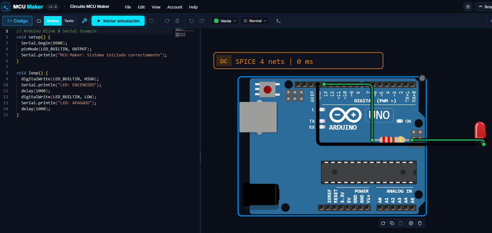
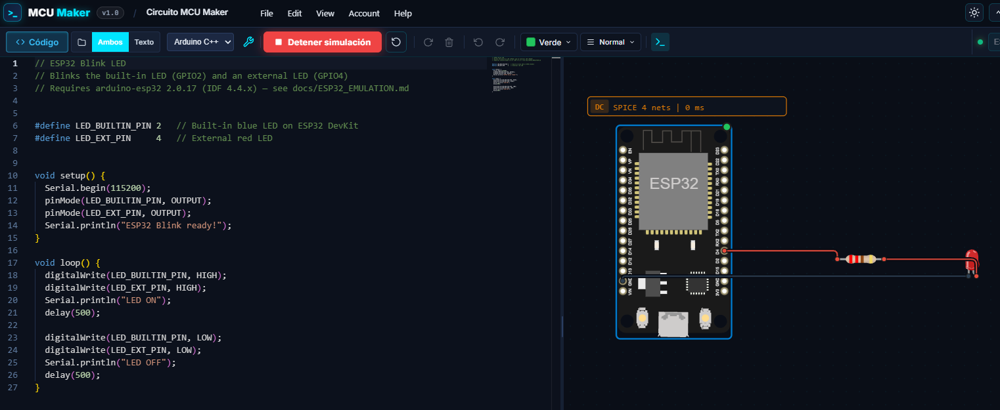
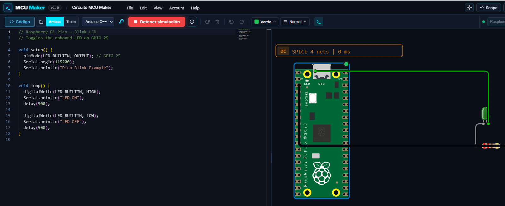
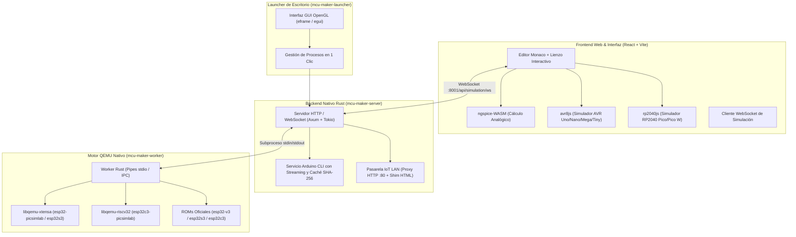

# MCU Maker — Plataforma Abierta de Simulación de Microcontroladores y Circuitos

<p align="center">
  <strong>Simulador y emulador interactivo de electrónica y microcontroladores de código abierto (Desktop + Web)</strong><br />
  <strong>MCU Maker v1.2.0 — Suite con Arquitectura Híbrida y Backend 100% en Rust</strong><br />
  <strong>Desarrollador Principal: Walther Curo De La Cruz</strong>
</p>

<p align="center">
  
  
  
</p>

<p align="center">
  
  
  
  
  
  
  
  
  
</p>

---

## Tabla de Contenidos

1. [¿Qué es MCU Maker?](#qué-es-mcu-maker)
2. [Vistas del Proyecto](#vistas-del-proyecto)
3. [Estado de Compatibilidad Multiplataforma](#estado-de-compatibilidad-multiplataforma)
4. [Placas Canónicas Compatibles (9 Placas Oficiales)](#placas-canónicas-compatibles)
5. [Catálogo de Componentes e Instrumentación](#catálogo-de-componentes-e-instrumentación)
6. [Arquitectura del Sistema](#arquitectura-del-sistema)
7. [Instalación y Primeros Pasos](#instalación-y-primeros-pasos)
8. [Guía de Verificación y Control de Calidad (QA Local)](#guía-de-verificación-y-control-de-calidad-qa-local)
9. [Resolución de Problemas Frecuentes (Troubleshooting)](#resolución-de-problemas-frecuentes-troubleshooting)
10. [Documentación Técnica Detallada](#documentación-técnica-detallada)
11. [Licencia, Autoría y Reconocimientos](#licencia-autoría-y-reconocimientos)

---

## ¿Qué es MCU Maker?

**MCU Maker** es una plataforma integral, moderna y abierta para el diseño, simulación e inspección de circuitos electrónicos y código para sistemas embebidos. Funciona de manera **100% local, privada y sin conexión a internet obligatoria** en tu estación de trabajo (así como en navegadores web modernos).

La plataforma resuelve la brecha entre el código de firmware y el hardware real combinando:

1. **Simulación Analógica SPICE en tiempo real:** Motor `ngspice` compilado a WebAssembly (`ngspice-WASM`) para cálculo nodal preciso de voltajes, transistores BJT/MOSFET, amplificadores operacionales y filtros pasivos/activos.
2. **Emulación Digital en el Navegador (Ciclo Exacto):** Motores WebAssembly/JavaScript ultrarrápidos para arquitecturas AVR8 (8-bit) y RP2040 (ARM Cortex-M0+ dual-core).
3. **Emulación Nativa QEMU de Alto Rendimiento:** Worker nativo desacoplado en Rust (`mcu-maker-worker`) que interactúa mediante FFI con librerías dinámicas de QEMU (`libqemu-xtensa` y `libqemu-riscv32`), permitiendo ejecutar firmware real sin modificar para la familia **ESP32** (incluyendo Wi-Fi emulado TCP/IP y servidores web reales vía Pasarela IoT).
4. **Servidor y Lanzador Nativo 100% en Rust:** Servidor HTTP/WebSocket ultraligero y asíncrono con **Axum**, caché de compilación SHA-256 con streaming en vivo para **Arduino CLI**, y una aplicación GUI de escritorio desarrollada en **eframe / egui**.

---

## Vistas del Proyecto

| Entorno de Trabajo — Arduino Uno R3 | Simulación QEMU — ESP32 DevKit V1 |
| :---: | :---: |
|  |  |
| *Editor de código con resaltado C/C++, diagnóstico en tiempo real y circuito SPICE con Arduino Uno R3.* | *Simulación nativa QEMU de ESP32 DevKit V1 ejecutando firmware Blink en GPIO 2 y GPIO 4.* |

<p align="center">
  
  <br />
  <em>Simulación interactiva de Raspberry Pi Pico con control de GPIO 25 integrado y LED externo en tiempo real.</em>
</p>

---

## Estado de Compatibilidad Multiplataforma

Como parte de los estándares de aseguramiento de calidad (QA), el alcance de soporte de sistemas operativos está definido de manera estricta y transparente:

### Plataformas Oficialmente Soportadas (Tier-1)

-  **Linux x86_64:**
  - **Sistemas objetivo:** Ubuntu 24.04 LTS (Noble Numbat), Debian 12 (Bookworm) y derivados (`.deb`), así como Fedora 39+, RHEL 9+, Rocky/AlmaLinux y openSUSE (`.rpm`) y paquete universal `.AppImage`.
  - **Formato de distribución:** Paquete nativo Debian (`dist-installer/mcu-maker_1.2.0_amd64.deb`), paquete nativo RPM (`dist-installer/mcu-maker-1.2.0-1.x86_64.rpm`) y portable (`dist-installer/MCU-Maker-1.2.0-x86_64.AppImage`), integrando binarios nativos en `/opt/mcu-maker/`, acceso directo `.desktop` y lanzador `/usr/bin/mcu-maker`.
  - **Librerías dinámicas:** QEMU runtime precompilado en formato ELF de 64 bits (`libqemu-xtensa.so`, `libqemu-riscv32.so`) y binarios ROM oficiales (`esp32-v3-rom.bin`, `esp32-v3-rom-app.bin`, `esp32c3-rom.bin`, `esp32s3_rev0_rom.bin`).
-  **Windows 10 / Windows 11 (64-bit):**
  - **Formato de distribución:** Instalador ejecutable oficial (`dist-installer/MCU-Maker-Setup-v1.2.0.exe`) y ejecución portable en un clic (`start-launcher.bat`).
  - **Librerías dinámicas:** QEMU runtime precompilado en formato PE/DLL de 64 bits (`libqemu-xtensa.dll`, `libqemu-riscv32.dll`) y ROMs colocadas junto a las DLLs para resolución directa `-L`.
-  **Web / Navegador Moderno:**
  - **Navegadores:** Google Chrome, Microsoft Edge, Mozilla Firefox, Brave, Opera.
  - **Requisitos:** Soporte para WebAssembly, Web Workers y WebSockets.

### Plataformas Descartadas / Sin Soporte

-  **macOS (Apple Silicon M1/M2/M3/M4 y macOS Intel):**

> [!WARNING]
> **AVISO DE QA:** El soporte para **macOS ha sido formal y permanentemente descartado**. No se proporcionan paquetes `.dmg`, binarios universales Mach-O ni librerías dinámicas `.dylib` para Darwin. El desarrollo y las pruebas se concentran exclusivamente en entornos Linux, Windows y Web.

---

## Placas Canónicas Compatibles

<p align="left">
  
  
  
</p>

El ecosistema de MCU Maker cuenta con exactamente **9 placas de desarrollo oficiales** rigurosamente verificadas en pruebas unitarias y de integración:

| N° | Placa Oficial | Arquitectura / SoC | Frecuencia | Motor de Emulación | Lenguajes y Toolchains |
| :---: | :--- | :--- | :---: | :--- | :--- |
| **1** | **Arduino Uno R3** | AVR8 (ATmega328P 8-bit) | 16 MHz | `avr8js` (Navegador) | Arduino C++, AVR Assembly |
| **2** | **Arduino Nano** | AVR8 (ATmega328P 8-bit) | 16 MHz | `avr8js` (Navegador) | Arduino C++, AVR Assembly |
| **3** | **Arduino Mega 2560** | AVR8 (ATmega2560 8-bit) | 16 MHz | `avr8js` (Navegador) | Arduino C++, AVR Assembly |
| **4** | **ATtiny85 (DIP-8)** | AVR8 (ATtiny85 8-bit) | 8/16 MHz | `avr8js` (Navegador) | Arduino C++, AVR Assembly |
| **5** | **Raspberry Pi Pico** | RP2040 (ARM Cortex-M0+ Dual) | 133 MHz | `rp2040js` (Navegador) | Arduino C++, MicroPython, Pico C/C++ SDK |
| **6** | **Raspberry Pi Pico W** | RP2040 + Wi-Fi CYW43439 | 133 MHz | `rp2040js` (Navegador) | Arduino C++, MicroPython, Pico C/C++ SDK |
| **7** | **ESP32 DevKit V1** | Xtensa LX6 Dual-Core | 240 MHz | QEMU Worker (`esp32-picsimlab`) | Arduino C++, MicroPython, ESP-IDF |
| **8** | **ESP32-S3 DevKit** | Xtensa LX7 Dual-Core (USB OTG) | 240 MHz | QEMU Worker (`esp32s3` + ROM oficial) | Arduino C++, MicroPython, ESP-IDF |
| **9** | **ESP32-C3 DevKit** | RISC-V RV32IMC Single-Core | 160 MHz | QEMU Worker (`esp32c3-picsimlab`) | Arduino C++, ESP-IDF |

> [!NOTE]
> **Nota de Versión (v1.2.0):** Los modelos *Arduino Nano ESP32* y *ESP32-CAM* han sido retirados formalmente del catálogo canónico para garantizar la máxima fidelidad y estabilidad operativa con las máquinas virtuales validadas de PICSimLab y QEMU Espressif.

---

## Catálogo de Componentes e Instrumentación

El entorno dispone de más de **160 componentes interactivos** categorizados para protoboards, esquemas y pruebas de laboratorio:

- **Sensores:** Sensor de distancia ultrasónico HC-SR04, Temperatura y Humedad DHT11 / DHT22, Barómetro digital BMP280, Acelerómetro y Giroscopio MPU6050 (I2C), Termistores NTC, Sensores de luz LDR, Potenciómetros rotativos y deslizantes.
- **Actuadores y Señalización:** LEDs estándar de colores, matriz y tiras NeoPixel direccionables (WS2812B), Servomotores (estándar de 180° y rotación continua), Relés electromecánicos de 5V/10A, Zumbadores acústicos pasivos y activos.
- **Displays y Visualización:** Pantalla OLED SSD1306 (128x64 y 128x32 en buses I2C y SPI), LCD alfanumérico 16x2 y 20x4 (con o sin adaptador I2C PCF8574), Displays de 7 segmentos de 1 y 4 dígitos (con control directo o multiplexado), Papel electrónico (e-Paper).
- **Circuitos Integrados Lógicos y Potencia:** Compuertas lógicas CMOS/TTL (74HC00, 74HC04, 74HC08, 74HC32, 74HC86), Temporizador analógico 555 (modos astable y monoestable), Registro de desplazamiento serial a paralelo 74HC595, Controlador Puente H de motores DC L293D.
- **Almacenamiento y Tiempo Real:** Relojes de tiempo real con respaldo DS1307 y DS3231 (I2C), Memoria EEPROM I2C 24Cxx, Lector de tarjetas MicroSD (SPI con montaje de sistema de archivos FAT).
- **Red Analógica SPICE:** Resistencias, Condensadores de filtrado, Inductores, Diodos 1N4007 y Zener, Transistores bipolares NPN 2N2222 y PNP 2N3906, MOSFETs de potencia canal N/P y Amplificadores operacionales LM358 / TL072.
- **Instrumentación:** Osciloscopio digital en tiempo real con selector dinámico de pines GPIO/analógicos, Monitor Serie interactivo y visualizador de terminal UART.

---

## Arquitectura del Sistema



### Flujo de Simulación ESP32

1. El usuario hace clic en **Iniciar Simulación** en un ESP32 DevKit V1, ESP32-S3 o ESP32-C3.
2. `mcu-maker-server` inicia el binario nativo `mcu-maker-worker` y, si detecta Wi-Fi en el sketch, asigna un puerto NAT (`hostfwd`) y registra el dispositivo en la Pasarela IoT (`/iot/` y `/api/gateway/`).
3. El worker carga la librería compartida correspondiente (`libqemu-xtensa.so/.dll` o `libqemu-riscv32.so/.dll`) y resuelve automáticamente las ROMs oficiales (`esp32-v3-rom.bin`, `esp32s3_rev0_rom.bin`, `esp32c3-rom.bin`).
4. Para **ESP32-S3**, el worker monta automáticamente la memoria flash de 8 MB y el bootloader ROM, resolviendo los 49 pines GPIO (`0..=48`).
5. Los eventos de pines, UART serie, estado Wi-Fi (`initializing` / `got_ip`) y lecturas analógicas se transmiten en tiempo real por WebSockets bidireccionales hacia el navegador.

---

## Instalación y Primeros Pasos

### 1. En Linux (Ubuntu / Debian `.deb` y Fedora / RHEL / openSUSE `.rpm`) 

#### Opción A: Instalador Oficial Debian / Ubuntu (`.deb`)

```bash
sudo apt update
sudo apt install ./dist-installer/mcu-maker_1.2.0_amd64.deb
```

#### Opción B: Instalador Oficial Fedora / RHEL / openSUSE (`.rpm`)

```bash
# Fedora / RHEL / Rocky / AlmaLinux:
sudo dnf install ./dist-installer/mcu-maker-1.2.0-1.x86_64.rpm

# openSUSE:
sudo zypper install ./dist-installer/mcu-maker-1.2.0-1.x86_64.rpm
```

Una vez instalado (`.deb` o `.rpm`), abre **MCU Maker** desde el menú de aplicaciones o ejecutando `mcu-maker` en la terminal. Para desinstalarlo, usa `sudo apt remove mcu-maker` o `sudo dnf remove mcu-maker`.

#### Opción C: Construcción desde Código Fuente

```bash
# 1. Instalar dependencias del sistema (apt / dnf / zypper), Rust y Arduino CLI
./install-deps-linux.sh

# 2. Descargar librerías del motor QEMU (libqemu-xtensa.so, libqemu-riscv32.so y ROMs)
./scripts/download-qemu-runtime.sh

# 3. Compilar los paquetes instaladores (.deb, .rpm y .AppImage)
./build-installer.sh      # Genera dist-installer/mcu-maker_1.2.0_amd64.deb
./build-rpm.sh            # Genera dist-installer/mcu-maker-1.2.0-1.x86_64.rpm
./build-appimage.sh       # Genera dist-installer/MCU-Maker-1.2.0-x86_64.AppImage
```

---

### 2. En Windows 10 / Windows 11 (64-bit) 

#### Opción A: Instalador Asistido (`.exe`)

1. Ejecuta el instalador oficial generado por `build-installer.bat` (`dist-installer/MCU-Maker-Setup-v1.2.0.exe`).
2. Sigue los pasos del asistente de Inno Setup (compatible sin privilegios de administrador).
3. Inicia **MCU Maker** desde el acceso directo del Escritorio.

#### Opción B: Ejecución Portable

En la raíz del repositorio clonado, ejecuta:

```bat
start-launcher.bat
```

El script detectará los ejecutables optimizados de Rust e iniciará el launcher y servidor automáticamente.

---

### 3. Modo Servidor para Red Local o Desarrollo Web 

```bash
# Compilar y arrancar el servidor backend en el puerto 8001
cd rust
cargo run --release -p mcu-maker-server -- --port 8001
```

En otra terminal, para levantar el frontend en modo desarrollo:

```bash
cd frontend
npm install --legacy-peer-deps
npm run dev
```

---

## Guía de Verificación y Control de Calidad (QA Local)

Para auditar y validar la integridad técnica de todo el proyecto de forma **100% local** (sin GitHub Actions), ejecuta el script unificado:

- **Windows :**
  ```powershell
  .\scripts\qa-local.ps1
  # Con instalación automática de dependencias npm faltantes:
  .\scripts\qa-local.ps1 -Install
  # Incluyendo pruebas de integración que requieren QEMU + arduino-cli:
  .\scripts\qa-local.ps1 -IncludeIgnored
  # Auditoría estricta completa:
  .\scripts\qa-local.ps1 -Strict
  ```
- **Linux :**
  ```bash
  ./scripts/qa-local.sh
  # O con instalación / pruebas de integración / modo estricto:
  ./scripts/qa-local.sh --install --include-ignored --strict
  ```

O ejecuta manualmente cada bloque:

### 1. Verificación del Backend y Workers en Rust

```bash
cd rust
cargo test --workspace
cargo test --workspace -- --ignored
cargo clippy --workspace --all-targets -- -D warnings
```

### 2. Verificación del Frontend, Sandbox de Circuitos y Extensión VS Code

```bash
cd frontend
npm run tsc
npm run check
npx vitest run
npm run build

# Sandbox de circuitos (ngspice-WASM + avr8js)
cd ../test/test_circuit
npm test

# Extensión de VS Code
cd ../../vscode-extension
npx tsc --noEmit
npm run build:extension
```

---

## Resolución de Problemas Frecuentes (Troubleshooting)

### 1. `Librería de simulación libqemu-xtensa.so / .dll no encontrada`

- **Causa:** Las librerías de emulación QEMU o las ROMs no fueron descargadas en `prebuilt/qemu_runtime`.
- **Solución:** Ejecuta en la raíz del proyecto `./scripts/download-qemu-runtime.sh` (Linux) o `.\scripts\download-qemu-runtime.ps1` (Windows).

### 2. `El simulador finalizó: qemu: Error: -bios argument not set, and ROM code binary not found`

- **Causa:** Los binarios ROM (`esp32-v3-rom.bin`, `esp32-v3-rom-app.bin`, `esp32c3-rom.bin`, `esp32s3_rev0_rom.bin`) deben residir junto a las librerías dinámicas o en `fw/`.
- **Solución:** Resuelto en **v1.2.0**: `download-qemu-runtime.ps1` copia todas las ROMs junto a las DLLs y `mcu-maker-worker` resuelve `lib_dir`, `fw/` y el directorio del binario.

### 3. Error al compilar sketches: `arduino-cli not found`

- **Causa:** El ejecutable `arduino-cli` no está instalado en el `PATH` del sistema ni en `prebuilt/arduino-cli/`.
- **Solución:** Ejecuta `./install-deps-linux.sh` (Linux) o `.\scripts\download-qemu-runtime.ps1` (Windows).

---

## Documentación Técnica Detallada

- **[`MANUAL_PROYECTO_V1.md`](MANUAL_PROYECTO_V1.md):** Manual completo de usuario, diseño de circuitos y arquitectura interna (v1.2.0).
- **[`README_RUST.md`](README_RUST.md):** Especificación técnica de los 3 crates de Rust (`mcu-maker-launcher`, `mcu-maker-server`, `mcu-maker-worker`).
- **[`docs/QA_TRACEABILITY.md`](docs/QA_TRACEABILITY.md):** Matriz de trazabilidad de bugs e issues en las ramas `Team_Windows` y `Team_Linux`.
- **[`docs/BOARDS_AND_COMPONENTS.md`](docs/BOARDS_AND_COMPONENTS.md):** Ficha técnica de pines, tensiones y memorias de las 9 placas canónicas.
- **[`docs/ESP32_EMULATION.md`](docs/ESP32_EMULATION.md):** Guía profunda de la emulación Xtensa y PICSimLab.
- **[`docs/RISCV_EMULATION.md`](docs/RISCV_EMULATION.md):** Detalles sobre la emulación del núcleo RISC-V en el ESP32-C3.

---

## Licencia, Autoría y Reconocimientos

### Licencia de Software Libre

Este proyecto se distribuye bajo los términos de la **[GNU Affero General Public License v3.0 (GNU AGPLv3)](LICENSE)**. Cualquier trabajo derivado o servicio de red basado en este software debe mantener el código fuente disponible bajo los mismos términos libres y recíprocos.

### Autoría y Créditos

- **Desarrollador Principal de MCU Maker Suite:** **Walther Curo De La Cruz** (2026)
  - Diseño integral y arquitectura completa en Rust: servidor asíncrono con Axum/Tokio, streaming y caché de compilación SHA-256, worker QEMU desacoplado, pasarela LAN IoT con proxy inverso y aplicación GUI de escritorio en `eframe`/`egui`.
  - Integración multiplataforma Windows / Linux, empaquetado de instaladores y aseguramiento de calidad local (`Team_Windows` / `Team_Linux`).
- **Proyecto Base:** Inspirado y derivado del frontend de código abierto de **[Velxio.dev](https://github.com/davidmonterocrespo24/velxio)**, creado por **David Montero Crespo**.
- **Núcleos de Emulación y SPICE:**
  - Motores de emulación digital en navegador basados en **Wokwi** (`avr8js` y `rp2040js` por Uri Shaked).
  - Motor de co-simulación analógica `ngspice-WASM`.
  - Emulación de microcontroladores QEMU adaptada del fork de **lcgamboa (PICSimLab)**.

---
*MCU Maker Suite v1.2.0 Oficial — Desarrollado por Walther Curo De La Cruz (2026).*
