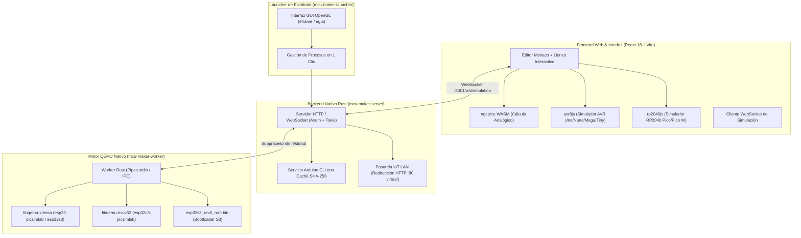

# MCU Maker: Plataforma Abierta de Simulación de Microcontroladores y Circuitos

<p align="center">
  <strong>Simulador y emulador interactivo de electrónica y microcontroladores de código abierto (Desktop + Web)</strong><br />
  <strong>MCU Maker — Suite con Arquitectura Híbrida y Backend 100% en Rust</strong><br />
  <strong>Autor Principal: Walther Curo De La Cruz</strong>
</p>

<p align="center">
  
  
  
  
  
  
  
  
  
</p>

---

## 📑 Tabla de Contenidos
1. [¿Qué es MCU Maker?](#-qué-es-mcu-maker)
2. [Estado de Compatibilidad Multiplataforma](#-estado-de-compatibilidad-multiplataforma)
3. [Placas Canónicas Compatibles (Lista Oficial de 10 Placas)](#-placas-canónicas-compatibles)
4. [Catálogo de Componentes e Instrumentación](#-catálogo-de-componentes-e-instrumentación)
5. [Arquitectura del Sistema](#-arquitectura-del-sistema)
6. [Instalación y Primeros Pasos](#-instalación-y-primeros-pasos)
7. [Guía de Verificación y Control de Calidad (QA)](#-guía-de-verificación-y-control-de-calidad-qa)
8. [Resolución de Problemas Frecuentes (Troubleshooting)](#-resolución-de-problemas-frecuentes-troubleshooting)
9. [Documentación Técnica Detallada](#-documentación-técnica-detallada)
10. [Licencia, Autoría y Reconocimientos](#-licencia-autoría-y-reconocimientos)

---

## 📌 ¿Qué es MCU Maker?

**MCU Maker** es una plataforma integral, moderna y abierta para el diseño, simulación e inspección de circuitos electrónicos y código para sistemas embebidos. Funciona de manera **100% local, privada y sin conexión a internet obligatoria** en tu estación de trabajo (así como en navegadores web modernos).

La plataforma resuelve la brecha entre el código de firmware y el hardware real combinando:
1. **Simulación Analógica SPICE en tiempo real:** Motor `ngspice` compilado a WebAssembly (`ngspice-WASM`) para cálculo nodal preciso de voltajes, transistores BJT/MOSFET, amplificadores operacionales y filtros pasivos/activos.
2. **Emulación Digital en el Navegador (Ciclo Exacto):** Motores WebAssembly/JavaScript ultrarrápidos para arquitecturas AVR8 (8-bit) y RP2040 (ARM Cortex-M0+ dual-core).
3. **Emulación Nativa QEMU de Alto Rendimiento:** Worker nativo desacoplado en Rust (`mcu-maker-worker`) que interactúa mediante FFI con librerías dinámicas de QEMU (`libqemu-xtensa` y `libqemu-riscv32`), permitiendo ejecutar firmware real sin modificar para la familia **ESP32** (incluyendo WiFi emulado TCP/IP y servidores web reales).
4. **Servidor y Lanzador Nativo 100% en Rust:** Servidor HTTP/WebSocket ultraligero y asíncrono con **Axum**, caché de compilación SHA-256 para **Arduino CLI**, y una aplicación GUI de escritorio desarrollada en **eframe / egui**.

---

## 💻 Estado de Compatibilidad Multiplataforma

Como parte de los estándares de aseguramiento de calidad (Senior QA), el alcance de soporte de sistemas operativos está definido de manera estricta y transparente:

### ✅ Plataformas Oficialmente Soportadas (Nivel 1 / Tier-1)
* **Linux x86_64:**
  * **Sistemas objetivo:** Ubuntu 24.04 LTS (Noble Numbat), Debian 12 (Bookworm) y derivados directos (Linux Mint, Pop!_OS).
  * **Formato de distribución:** Paquete nativo Debian (`dist-installer/mcu-maker_1.0.0_amd64.deb`), integrando binarios nativos en `/opt/mcu-maker/`, acceso directo de escritorio `.desktop` y lanzador `/usr/bin/mcu-maker`.
  * **Librerías dinámicas:** QEMU runtime precompilado en formato ELF de 64 bits (`libqemu-xtensa.so`, `libqemu-riscv32.so`) y binario ROM oficial `esp32s3_rev0_rom.bin`.
* **Windows 10 / Windows 11 (64-bit):**
  * **Formato de distribución:** Instalador ejecutable oficial (`dist-installer/MCU-Maker-Setup-v1.0.0.exe`) y ejecución portable en un clic (`start-launcher.bat`).
  * **Librerías dinámicas:** QEMU runtime precompilado en formato PE/DLL de 64 bits (`libqemu-xtensa.dll`, `libqemu-riscv32.dll`).
* **Web / Navegador Moderno:**
  * **Navegadores:** Google Chrome, Microsoft Edge, Mozilla Firefox, Brave, Opera.
  * **Requisitos:** Soporte para WebAssembly, Web Workers y WebSockets.

### ❌ Plataformas Descartadas / Sin Soporte
* **macOS (Apple Silicon M1/M2/M3/M4 y macOS Intel):**
  > **AVISO DE QA:** El soporte para **macOS ha sido formal y permanentemente descartado**. No se proporcionan paquetes `.dmg`, binarios universales Mach-O ni librerías dinámicas `.dylib` para Darwin. El desarrollo y los pipelines de control de calidad se concentran exclusivamente en entornos de producción Linux, Windows y Web.

---

## ⚡ Placas Canónicas Compatibles

El ecosistema de MCU Maker cuenta con exactamente **10 placas de desarrollo oficiales** rigurosamente verificadas en pruebas unitarias y de integración:

| N° | Placa Oficial | Arquitectura / SoC | Frecuencia | Motor de Emulación | Lenguajes y Toolchains |
| :---: | :--- | :--- | :---: | :--- | :--- |
| **1** | **Arduino Uno R3** | AVR8 (ATmega328P 8-bit) | 16 MHz | `avr8js` (Navegador) | Arduino C++, AVR Assembly |
| **2** | **Arduino Nano** | AVR8 (ATmega328P 8-bit) | 16 MHz | `avr8js` (Navegador) | Arduino C++, AVR Assembly |
| **3** | **Arduino Mega 2560** | AVR8 (ATmega2560 8-bit) | 16 MHz | `avr8js` (Navegador) | Arduino C++, AVR Assembly |
| **4** | **ATtiny85 (DIP-8)** | AVR8 (ATtiny85 8-bit) | 8/16 MHz | `avr8js` (Navegador) | Arduino C++, AVR Assembly |
| **5** | **Raspberry Pi Pico** | RP2040 (ARM Cortex-M0+ Dual) | 133 MHz | `rp2040js` (Navegador) | Arduino C++, MicroPython, Pico C/C++ SDK |
| **6** | **Raspberry Pi Pico W** | RP2040 + Wi-Fi CYW43439 | 133 MHz | `rp2040js` (Navegador) | Arduino C++, MicroPython, Pico C/C++ SDK |
| **7** | **ESP32 DevKit V1** | Xtensa LX6 Dual-Core | 240 MHz | QEMU Worker (`esp32-picsimlab`) | Arduino C++, MicroPython, ESP-IDF |
| **8** | **ESP32-CAM** | Xtensa LX6 Dual + Cámara OV2640 | 240 MHz | QEMU Worker (`esp32-picsimlab`) | Arduino C++, MicroPython, ESP-IDF |
| **9** | **ESP32-S3 DevKit** | Xtensa LX7 Dual-Core (USB OTG) | 240 MHz | QEMU Worker (`esp32s3` + ROM oficial) | Arduino C++, MicroPython, ESP-IDF |
| **10** | **ESP32-C3 DevKit** | RISC-V RV32IMC Single-Core | 160 MHz | QEMU Worker (`esp32c3-picsimlab`) | Arduino C++, ESP-IDF |

> ℹ️ **Nota de Versión:** El modelo *Arduino Nano ESP32* ha sido retirado formalmente del catálogo canónico para garantizar la máxima fidelidad y estabilidad operativa con las máquinas virtuales validadas de PICSimLab y QEMU Espressif.

---

## 🧩 Catálogo de Componentes e Instrumentación

El entorno dispone de más de **160 componentes interactivos** categorizados para protoboards, esquemas y pruebas de laboratorio:

* **Sensores:** Sensor de distancia ultrasónico HC-SR04, Temperatura y Humedad DHT11 / DHT22, Barómetro digital BMP280, Acelerómetro y Giroscopio MPU6050 (I2C), Termistores NTC, Sensores de luz LDR, Potenciómetros rotativos y deslizantes.
* **Actuadores y Señalización:** LEDs estándar de colores, matriz y tiras NeoPixel direccionables (WS2812B), Servomotores (estándar de 180° y rotación continua), Relés electromecánicos de 5V/10A, Zumbadores acústicos pasivos y activos.
* **Displays y Visualización:** Pantalla OLED SSD1306 (128x64 y 128x32 en buses I2C y SPI), LCD alfanumérico 16x2 y 20x4 (con o sin adaptador I2C PCF8574), Displays de 7 segmentos de 1 y 4 dígitos (con control directo o multiplexado), Papel electrónico (e-Paper).
* **Circuitos Integrados Lógicos y Potencia:** Compuertas lógicas CMOS/TTL (74HC00, 74HC04, 74HC08, 74HC32, 74HC86), Temporizador analógico 555 (modos astable y monoestable), Registro de desplazamiento serial a paralelo 74HC595, Controlador Puente H de motores DC L293D.
* **Almacenamiento y Tiempo Real:** Relojes de tiempo real con respaldo DS1307 y DS3231 (I2C), Memoria EEPROM I2C 24Cxx, Lector de tarjetas MicroSD (SPI con montaje de sistema de archivos FAT).
* **Red Analógica SPICE:** Resistencias, Condensadores de filtrado, Inductores, Diodos 1N4007 y Zener, Transistores bipolares NPN 2N2222 y PNP 2N3906, MOSFETs de potencia canal N/P y Amplificadores operacionales LM358 / TL072.
* **Instrumentación:** Osciloscopio digital en tiempo real con selector dinámico de pines GPIO/analógicos, Monitor Serie interactivo y visualizador de terminal UART.

---

## 🏗️ Arquitectura del Sistema



### Flujo de Simulación ESP32:
1. El usuario hace clic en **Iniciar Simulación** en un ESP32, ESP32-CAM, ESP32-S3 o ESP32-C3.
2. `mcu-maker-server` inicia el binario nativo `mcu-maker-worker`.
3. El worker carga la librería compartida correspondiente (`libqemu-xtensa.so/.dll` o `libqemu-riscv32.so/.dll`).
4. Para **ESP32-S3**, el worker monta automáticamente la memoria flash y el bootloader ROM (`esp32s3_rev0_rom.bin`), resolviendo los 49 pines GPIO (0..=48).
5. Los eventos de pines, UART serie y lecturas analógicas se transmiten con latencia mínima (< 2 ms) por WebSockets bidireccionales hacia el navegador.

---

## 🚀 Instalación y Primeros Pasos

### 🐧 1. En Linux (Ubuntu 24.04 LTS / Debian 12 x86_64)

#### Opción A: Instalador Oficial (.deb) — Recomendado
Si tienes el archivo `.deb` generado:
```bash
sudo apt update
sudo apt install ./dist-installer/mcu-maker_1.0.0_amd64.deb
```
Una vez instalado, abre **MCU Maker** desde el menú de aplicaciones de tu entorno gráfico o ejecutando `mcu-maker` en la terminal.

Para desinstalarlo:
```bash
sudo apt remove mcu-maker
```

#### Opción B: Construcción desde Código Fuente
Si has clonado el repositorio:
```bash
# 1. Instalar dependencias del sistema y Arduino CLI
./install-deps-linux.sh

# 2. Descargar librerías del motor QEMU (libqemu-xtensa, libqemu-riscv32 y ROM S3)
./scripts/download-qemu-runtime.sh

# 3. Compilar el paquete instalador .deb completo
./build-installer.sh
```

---

### 🪟 2. En Windows 10 / Windows 11 (64-bit)

#### Opción A: Instalador Asistido (.exe)
1. Descarga y ejecuta el instalador oficial:
   ```
   dist-installer/MCU-Maker-Setup-v1.0.0.exe
   ```
2. Sigue los pasos del asistente de instalación.
3. Inicia **MCU Maker** desde el acceso directo del Escritorio.

#### Opción B: Ejecución Portable
En la raíz del repositorio clonado, ejecuta:
```bat
start-launcher.bat
```
El script detectará los ejecutables optimizados de Rust e iniciará el launcher y servidor automáticamente.

---

### 🌐 3. Modo Servidor para Red Local o Desarrollo Web

Para levantar el servidor backend de manera independiente:
```bash
# Compilar y arrancar el servidor backend en el puerto 8001
cd rust
cargo run --release -p mcu-maker-server -- --port 8001
```
En otra terminal, puedes levantar el frontend en modo desarrollo:
```bash
cd frontend
npm install
npm run dev
```

---

## 🧪 Guía de Verificación y Control de Calidad (QA)

Para auditar y validar la integridad técnica de todo el proyecto, ejecuta la siguiente batería de pruebas de nivel Senior QA:

### 1. Verificación del Backend y Workers en Rust
```bash
cd rust

# Ejecutar todos los tests unitarios del workspace (servidor y worker QEMU)
cargo test --workspace

# Comprobación estricta de lints y calidad de código (Cero Advertencias)
cargo clippy --workspace -- -D warnings
```
**Resultado esperado:**
* 4 tests pasados en `mcu-maker-server` (incluyendo resolución de rutas QEMU y configuración de Arduino CLI).
* 4 tests pasados en `mcu-maker-worker` (incluyendo verificación de librerías QEMU cargables y presencia de la ROM `esp32s3_rev0_rom.bin`).
* 0 advertencias de Clippy.

### 2. Verificación del Frontend y Tipos de Placas
```bash
cd frontend

# Ejecutar la suite de pruebas unitarias sobre las 10 placas canónicas
npx vitest run \
  src/__tests__/canonical-16-boards.test.ts \
  src/__tests__/board-kinds-coverage.test.ts \
  src/__tests__/board-pin-mapping.test.ts \
  src/__tests__/esp32-adc-channel-map.test.ts \
  src/__tests__/esp32-element-onboard-led.test.ts \
  src/__tests__/issue-122-micropython-esp32.test.ts \
  src/__tests__/issue-139-espidf-mode.test.ts \
  src/__tests__/onboard-leds-attach.test.ts \
  src/__tests__/onboard-led-table.test.ts \
  src/__tests__/board-on-canvas-onboard-led.test.ts
```
**Resultado esperado:**
* 10 archivos de prueba aprobados (100% passed).
* 148 pruebas unitarias superadas con éxito.

### 3. Verificación de Compilación de Producción del Frontend
```bash
cd frontend
npx vite build
```
**Resultado esperado:**
* Compilación exitosa en `frontend/dist` sin errores de bundle.

---

## 🔧 Resolución de Problemas Frecuentes (Troubleshooting)

### 1. `Librería de simulación libqemu-xtensa.so no encontrada`
* **Causa:** Las librerías de emulación QEMU no fueron descargadas en la carpeta `prebuilt/qemu_runtime`.
* **Solución:** Ejecuta en la raíz del proyecto:
  ```bash
  ./scripts/download-qemu-runtime.sh
  ```
  Esto descargará `libqemu-xtensa.so`, `libqemu-riscv32.so` y la ROM del ESP32-S3 automáticamente.

### 2. `El simulador finalizó: Use -machine help to list supported machines`
* **Causa:** QEMU de PICSimLab requiere identificadores de máquina específicos.
* **Solución:** Ya se encuentra resuelto en la versión actual. Las máquinas oficiales asignadas son:
  * ESP32 clásico / ESP32-CAM: `esp32-picsimlab`
  * ESP32-S3: `esp32s3` (requiere `esp32s3_rev0_rom.bin`)
  * ESP32-C3: `esp32c3-picsimlab`

### 3. Error al compilar sketches: `arduino-cli not found`
* **Causa:** El ejecutable `arduino-cli` no está instalado en el PATH del sistema ni en `prebuilt/arduino-cli/`.
* **Solución:** Ejecuta `./install-deps-linux.sh` o descarga el binario oficial de Arduino CLI y colócalo en tu PATH.

---

## 📖 Documentación Técnica Detallada

* **[`MANUAL_PROYECTO_V1.md`](MANUAL_PROYECTO_V1.md):** Manual completo de usuario, diseño de circuitos y arquitectura interna.
* **[`README_RUST.md`](README_RUST.md):** Especificación técnica de los 3 crates de Rust (`mcu-maker-launcher`, `mcu-maker-server`, `mcu-maker-worker`).
* **[`docs/BOARDS_AND_COMPONENTS.md`](docs/BOARDS_AND_COMPONENTS.md):** Ficha técnica detallada de pines, tensiones y memorias de las 10 placas canónicas.
* **[`docs/ESP32_EMULATION.md`](docs/ESP32_EMULATION.md):** Guía profunda de la emulación Xtensa y PICSimLab.
* **[`docs/RISCV_EMULATION.md`](docs/RISCV_EMULATION.md):** Detalles sobre la emulación del núcleo RISC-V en el ESP32-C3.

---

## ⚖️ Licencia, Autoría y Reconocimientos

### Licencia de Software Libre
Este proyecto se distribuye bajo los términos de la **[GNU Affero General Public License v3.0 (GNU AGPLv3)](LICENSE)**. Cualquier trabajo derivado o servicio de red basado en este software debe mantener el código fuente disponible bajo los mismos términos libres y recíprocos.

### Autoría y Créditos
* **MCU Maker Suite:** Desarrollado por **Walther Curo De La Cruz** (2026).
  * Arquitectura completa en Rust: Servidor asíncrono con Axum, worker QEMU desacoplado, pasarela LAN IoT y GUI de escritorio con egui.
* **Proyecto Base:** Inspirado y derivado del frontend de código abierto de **[Velxio.dev](https://github.com/davidmonterocrespo24/velxio)**, creado por **David Montero Crespo**.
* **Núcleos de Emulación y SPICE:**
  * Motores de emulación digital en navegador basados en **Wokwi** (`avr8js` y `rp2040js` por Uri Shaked).
  * Motor de co-simulación analógica `ngspice-WASM`.
  * Emulación de microcontroladores QEMU adaptada del fork de **lcgamboa (PICSimLab)**.

---
*MCU Maker Suite v1.0.0 Oficial — 2026. Calidad Verificada.*
