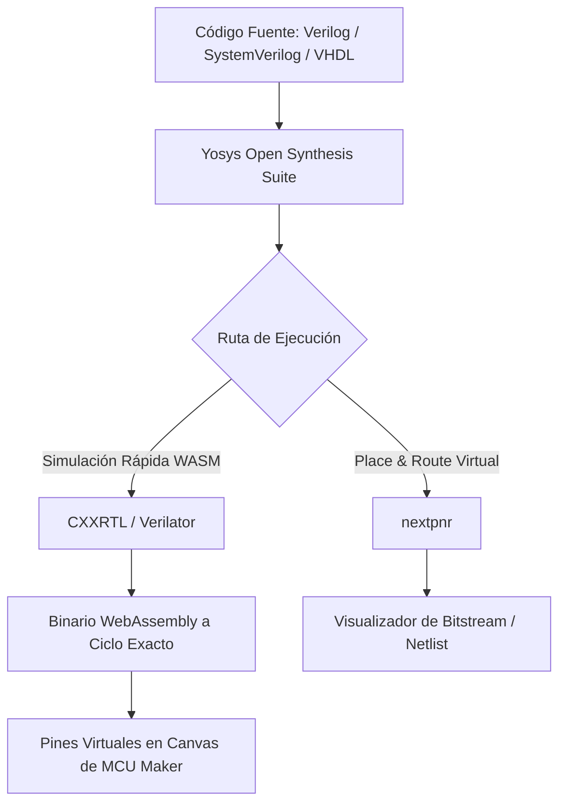

# 📋 Catálogo Oficial de Placas, Componentes y Roadmap FPGA — MCU Maker

Este documento contiene el inventario exhaustivo de todas las placas de desarrollo, familias de microcontroladores y componentes de hardware simulados disponibles en **MCU Maker**, así como la propuesta arquitectónica para la **futura integración de FPGAs**.

---

## 📑 Tabla de Contenidos
1. [Placas de Desarrollo y Microcontroladores Disponibles (11 Modelos Canónicos)](#1-placas-de-desarrollo-y-microcontroladores-disponibles-11-modelos-canónicos)
   - [Familia Arduino (AVR 8-bit)](#a-familia-arduino-arquitectura-avr-8-bit--motor-avr8js)
   - [Familia ESP32 (Xtensa Dual-Core)](#b-familia-esp32-arquitectura-xtensa-dual-core--motor-qemu-nativo)
   - [Familia ESP32 RISC-V](#c-familia-esp32-risc-v-arquitectura-risc-v-rv32imc--motor-qemu-nativo)
   - [Familia Raspberry Pi Pico (RP2040 ARM Cortex-M0+)](#d-familia-raspberry-pi-pico-arquitectura-arm-cortex-m0--motor-rp2040js)
2. [Catálogo de Componentes (> 160 Dispositivos)](#2-catálogo-de-componentes--160-dispositivos)
   - [Entradas y Sensores](#-entradas-y-sensores)
   - [Salidas, Actuadores y Motores](#-salidas-actuadores-y-motores)
   - [Pantallas y Visualización (Displays)](#-pantallas-y-visualización-displays)
   - [Pasivos y Analógicos (Motor SPICE / ngspice-WASM)](#-pasivos-y-analógicos-motor-spice--ngspice-wasm)
   - [Circuitos Integrados y Lógica Digital (Serie 74HC y Primitivas)](#-circuitos-integrados-y-lógica-digital-serie-74hc-y-primitivas)
   - [Chips Personalizados (Custom Chips SDK)](#-chips-personalizados-custom-chips-sdk)
3. [Roadmap de Expansión: Integración de FPGAs (Futuras Versiones)](#3-roadmap-de-expansión-integración-de-fpgas-futuras-versiones)
   - [Modelos Seleccionados para Educación y Makers](#a-modelos-propuestos-para-incorporación)
   - [Pila Tecnológica Sugerida (100% Open Source / WASM)](#b-pila-tecnológica-sugerida-toolchain-libre-y-ligero)
   - [Arquitectura de Co-Simulación Híbrida (FPGA + MCU + SPICE)](#c-arquitectura-de-co-simulación-híbrida)

---

# 1. Placas de Desarrollo y Microcontroladores Disponibles (11 Modelos Canónicos)

### A. Familia Arduino (Arquitectura AVR 8-bit · Motor `avr8js`)
*Simulación de ciclo exacto en el navegador a 16 MHz con soporte de interrupciones, temporizadores, ADC y periféricos.*

| Placa | Microcontrolador | Memoria Flash / SRAM | E/S y Características Principales |
| :--- | :--- | :--- | :--- |
| **Arduino Uno R3** | ATmega328P @ 16 MHz | 32 KB Flash / 2 KB SRAM | 14 pines digitales (6 PWM), 6 analógicos. Estándar educativo. |
| **Arduino Nano** | ATmega328P @ 16 MHz | 32 KB Flash / 2 KB SRAM | Formato compacto para protoboard, 8 pines analógicos (A0-A7). |
| **Arduino Mega 2560** | ATmega2560 @ 16 MHz | 256 KB Flash / 8 KB SRAM | 54 pines digitales (15 PWM), 16 analógicos, 4 puertos serie UART. |
| **ATtiny85 (DIP-8)** | ATtiny85 @ 8/16 MHz | 8 KB Flash / 512 B SRAM | Microcontrolador ultracompacto de 8 pines, 6 GPIOs, SPI/I2C USI. |

---

### B. Familia ESP32 (Arquitectura Xtensa Dual-Core · Motor QEMU Nativo)
*Emulación completa sobre máquina virtual QEMU nativa en Rust, con WiFi virtual TCP/IP (DHCP 192.168.4.15), WebSockets y pasarela IoT LAN.*

| Placa | SoC / Núcleo | Frecuencia / Memoria | Conectividad y Periféricos |
| :--- | :--- | :--- | :--- |
| **ESP32 DevKit V1** | Xtensa LX6 dual-core | 240 MHz, 4 MB Flash | WiFi 802.11 b/g/n, BLE, 30/38 pines, 2 DAC, 18 ADC, touch pins. |
| **ESP32-CAM** | Xtensa LX6 dual-core | 240 MHz, 4 MB PSRAM | Interfaz de cámara OV2640 de 2 MP, slot para tarjeta microSD. |
| **ESP32-S3 DevKit** | Xtensa LX7 dual-core | 240 MHz, 8 MB Flash | Instrucciones vectoriales AI, USB OTG nativo, RGB WS2812. |

---

### C. Familia ESP32 RISC-V (Arquitectura RISC-V RV32IMC · Motor QEMU Nativo)
*Arquitectura abierta RISC-V de 32 bits emulada nativamente con compatibilidad para Arduino C++ y ESP-IDF.*

| Placa | Microcontrolador | Frecuencia / Memoria | Características |
| :--- | :--- | :--- | :--- |
| **ESP32-C3 DevKit** | RISC-V RV32IMC single-core | 160 MHz, 4 MB Flash | WiFi 4 + Bluetooth 5 LE, 22 GPIOs, UART, SPI, I2C, I2S. |

---

### D. Familia Raspberry Pi Pico (Arquitectura ARM Cortex-M0+ · Motor `rp2040js`)
*Microcontrolador RP2040 con soporte para Arduino C++ y MicroPython en el navegador.*

| Placa | SoC / Arquitectura | Memoria | Periféricos Destacados |
| :--- | :--- | :--- | :--- |
| **Raspberry Pi Pico** | RP2040 dual Cortex-M0+ @ 133 MHz | 2 MB Flash / 264 KB SRAM | 26 pines GPIO, 3 ADC, 2 UART, 2 SPI, 2 I2C, 8 máquinas PIO. |
| **Raspberry Pi Pico W** | RP2040 dual Cortex-M0+ @ 133 MHz | 2 MB Flash / 264 KB SRAM | Módulo inalámbrico Infineon CYW43439 (WiFi 802.11n). |

---

# 2. Catálogo de Componentes (> 160 Dispositivos)

### 🌡️ Entradas y Sensores
- **HC-SR04**: Sensor de distancia por ultrasonidos (rango de 2 cm a 400 cm con resolución milimétrica).
- **DHT22 / AM2302**: Sensor digital calibrado de temperatura ambiental y humedad relativa de alta precisión.
- **BMP280**: Sensor barométrico digital para medición de presión atmosférica y altitud (I2C/SPI).
- **MPU-6050**: Unidad de medición inercial de 6 grados de libertad (acelerómetro y giróscopo triaxial).
- **PIR Motion Sensor**: Sensor de movimiento por infrarrojos pasivos con ajuste de tiempo y sensibilidad.
- **LDR (Fotoresistencia)**: Resistencia variable según la intensidad lumínica ambiental.
- **Fotodiodo**: Diodo sensible a la radiación lumínica de conmutación rápida.
- **Sensor de Flexión (Flex Sensor)**: Resistencia variable en función del radio de curvatura.
- **Sensor de Fuerza (FSR)**: Resistencia sensible a la presión mecánica aplicada sobre su superficie.
- **Termistor NTC**: Sensor resistivo con coeficiente térmico negativo para medición analógica de temperatura.
- **Sensor de Pulso Cardíaco**: Sensor óptico fotopletismográfico de latidos y frecuencia cardíaca.
- **Sensor de Gas MQ**: Detector analógico y digital de gases inflamables, humo y GLP.
- **Sensor de Llama**: Sensor óptico detector de radiación infrarroja de fuego.
- **Sensor de Sonido Grande (Big Sound Sensor)**: Micrófono con salida analógica directa y comparador digital.
- **Sensor de Sonido Pequeño (Small Sound Sensor)**: Módulo de micrófono de electret compacto.
- **Sensor de Inclinación (Tilt Switch)**: Interruptor de mercurio/bola metálica para detección de posición.
- **HX711**: Amplificador y convertidor analógico-digital de 24 bits para celdas de carga y balanzas.
- **GPS NEO-6M**: Módulo satelital con comunicación serie UART y sentencias NMEA (coordenadas, velocidad, altitud).
- **Joystick Analógico**: Control bidireccional X/Y con dos potenciómetros y botón pulsador integrado.
- **Potenciómetro Rotativo**: Resistencia variable giratoria de 3 terminales (valores configurables).
- **Potenciómetro Deslizante (Slide Potentiometer)**: Control lineal deslizante estilo mesa de mezclas.
- **Encoder Rotativo KY-040**: Codificador de cuadratura digital con giro continuo de 360° y pulsador.
- **Pulsadores Táctiles (Pushbuttons)**: Pulsadores momentáneos NA de 6 mm y 12 mm.
- **Interruptor Deslizante (Slide Switch)**: Conmutador bipolar SPDT.
- **DIP Switch (8 vías)**: Bloque de 8 micro-interruptores independientes para configuración digital.
- **Teclado de Membrana 4x4**: Matriz de 16 teclas numéricas y alfanuméricas (filas/columnas).
- **Receptor Infrarrojo (TSOP)**: Receptor óptico demodulador a 38 kHz para decodificación de mandos.
- **Control Remoto Infrarrojo**: Emisor IR interactivo con panel de botones numéricos y de control.
- **DS1307**: Reloj de tiempo real RTC I2C con reloj calendario y memoria NVRAM.
- **DS3231**: Reloj de tiempo real I2C de ultra-alta precisión compensado térmicamente (TCXO).

---

### 💡 Salidas, Actuadores y Motores
- **LEDs estándar**: Diodos emisores de luz con voltaje directo, corriente y color configurable (Rojo, Verde, Azul, Amarillo, Blanco, Naranja).
- **LED RGB**: Diodo emisor de 3 colores independientes en encapsulado único (ánodo común y cátodo común).
- **Barra de LEDs (10 segmentos)**: Matriz lineal de 10 LEDs para indicadores de nivel analógico.
- **Anillo de NeoPixels**: Aro circular con 16/24 LEDs inteligentes RGB direccionables WS2812B.
- **Matriz de NeoPixels (8x8)**: Panel matricial de 64 LEDs direccionables por un solo pin.
- **Display de 7 Segmentos**: Dígito LED numérico con punto decimal (cátodo y ánodo común).
- **Buzzer Piezoeléctrico**: Zumbador acústico activo y pasivo para síntesis de frecuencias PWM.
- **Servomotor (SG90 / Estándar)**: Motor con reductora y potenciómetro para control de ángulo de 0° a 180°.
- **Motor Paso a Paso Bipolar**: Motor de precisión angular por pasos (4 cables).
- **Motor Paso a Paso Biaxial**: Motor de dos ejes independientes.
- **Controlador A4988**: Driver para motores paso a paso con regulador de corriente y microstepping (1/16).
- **Driver de Motores L293D**: Doble puente H integrado para control bidireccional y PWM de 2 motores DC.
- **Motorreductor DC**: Motor de corriente continua acoplado a caja de engranajes plástica.
- **Relé Electromecánico SPDT**: Conmutador electromecánico para control de cargas de red eléctrica (AC/DC).
- **Relé de Telecomunicaciones KS2E**: Relé miniatura de señal de bajo consumo.
- **Bombilla Incandescente**: Carga resistiva con emisión lumínica y filamento térmico simulado.

---

### 📟 Pantallas y Visualización (Displays)
- **LCD 1602**: Pantalla monocromática de cristal líquido de 16 columnas x 2 filas (bus paralelo 4/8 bits).
- **LCD 1602 I2C**: Versión con expansor I2C PCF8574 (comunicación mediante 2 pines SDA/SCL).
- **LCD 2004**: Pantalla grande de 20 columnas x 4 filas en versiones paralela e I2C.
- **OLED SSD1306 (128x64)**: Pantalla gráfica monocromática de alta nitidez en interfaces I2C y SPI.
- **TFT Color ILI9341**: Pantalla gráfica a color de 320x240 píxeles con bus SPI de alta velocidad.
- **Serie Completa de Displays de Tinta Electrónica (ePaper)**:
  - ePaper 1.54" (200x200 Blanco y Negro)
  - ePaper 2.13" (250x122 Blanco y Negro)
  - ePaper 2.13" Tricolor (Blanco, Negro y Rojo)
  - ePaper 2.9" (296x128 Blanco y Negro)
  - ePaper 2.9" Tricolor (Blanco, Negro y Rojo)
  - ePaper 4.2" (400x300 Blanco y Negro)
  - ePaper 5.65" Multicolor (600x448 tecnología ACeP de 7 colores)
  - ePaper 7.5" (800x480 Blanco y Negro gran formato)

---

### ⚡ Pasivos y Analógicos (Motor SPICE / `ngspice-WASM`)
- **Protoboards**: Breadboard estándar de 830 puntos de inserción y Mini de 400 puntos.
- **Resistencias de Película Metálica**: 220Ω, 330Ω, 470Ω, 1kΩ, 2.2kΩ, 4.7kΩ, 10kΩ, 22kΩ, 47kΩ, 100kΩ, 1MΩ y valor personalizado con bandas de color dinámicas.
- **Condensadores Cerámicos**: 10pF, 22pF, 100pF, 1nF, 10nF, 100nF, 1µF.
- **Condensadores Electrolíticos**: 1µF, 10µF, 47µF, 100µF, 470µF, 1000µF con cálculo de polarización y constantes de tiempo RC.
- **Inductores**: 100µH, 1mH, 10mH y valor configurable para filtros LC y fuentes conmutadas.
- **Diodos Rectificadores**: 1N4007 (hasta 1000 V), 1N4148 (conmutación ultrarrápida para señales).
- **Diodo Zener 1N4733**: Diodo de regulación con tensión de ruptura inversa de 5.1 V.
- **Diodos Schottky**: 1N5817 (20 V), 1N5819 (40 V) con tensión directa reducida (~0.2 V - 0.3 V).
- **Transistores BJT NPN**: 2N2222 (propósito general), BC547 (audio y señal), 2N3055 (potencia TO-3 de hasta 15 A).
- **Transistores BJT PNP**: 2N3906, BC557.
- **MOSFETs de Canal N**: 2N7000 (señal lógica), IRF540 (potencia de conmutación rápida).
- **MOSFETs de Canal P**: FQP27P06, IRF9540 (control de potencia por lado alto).
- **Amplificadores Operacionales**:
  - Amplificador Operacional Ideal (sin saturación ni corrientes parásitas).
  - LM741: El modelo educativo estándar.
  - LM358: Doble operacional optimizado para fuentes simples de 0 a 5 V.
  - LM324: Cuádruple amplificador operacional para acondicionamiento multicanal.
  - TL072: Doble amplificador con entradas JFET para instrumentación de bajo ruido.
- **Optoacopladores**: 4N25 (salida fototransistor con terminal de base) y PC817 (aislamiento galvánico óptico).
- **Reguladores de Voltaje Lineales**:
  - 7805 (+5 V DC)
  - 7812 (+12 V DC)
  - 7905 (−5 V DC para rieles negativos)
  - LM317 (Regulador lineal ajustable con divisor resistivo)
- **Fuentes e Instrumentación**:
  - Batería de 9 V, Pila AA de 1.5 V, Pila de botón CR2032 de 3 V.
  - Fuente de Laboratorio Regulada (voltaje y límite de corriente configurables).
  - Generador de Señales (ondas Senoidales, Cuadradas, Triangulares con amplitud, offset y frecuencia ajustables).
  - Tarjeta MicroSD con sistema de archivos FAT emulado y persistencia.

---

### 🧠 Circuitos Integrados y Lógica Digital (Serie 74HC y Primitivas)
- **74HC00**: 4 compuertas NAND de 2 entradas.
- **74HC02**: 4 compuertas NOR de 2 entradas.
- **74HC04**: 6 inversores NOT de alta velocidad.
- **74HC08**: 4 compuertas AND de 2 entradas.
- **74HC14**: 6 inversores con disparador Schmitt Trigger (inmunidad al ruido).
- **74HC32**: 4 compuertas OR de 2 entradas.
- **74HC86**: 4 compuertas XOR (O exclusiva) de 2 entradas.
- **Compuertas Lógicas Primitivas**: AND (2, 3 y 4 entradas), OR (2, 3 y 4 entradas), NAND (2, 3 y 4 entradas), NOR (2, 3 y 4 entradas), XOR, XNOR, NOT (Inversor).
- **Flip-Flops Biestables**: Flip-Flop Tipo D (con reloj, entrada D y reset asíncrono), Flip-Flop Tipo JK, Flip-Flop Tipo T.

---

### 🧩 Chips Personalizados (Custom Chips SDK)
- **Entorno SDK WebAssembly**: Cabecera `sdk/mcu_maker_chip.h` para crear cualquier circuito integrado a medida programándolo en **C**, **C++** o **Rust**, permitiendo extender el simulador con chips propietarios, controladores de buses o protocolos específicos.

---

# 3. Roadmap de Expansión: Integración de FPGAs (Futuras Versiones)

> [!NOTE]
> **Estado del Módulo FPGA:** Esta sección define la propuesta técnica y arquitectónica planificada para futuras versiones de MCU Maker. **No está implementada en la versión actual** y sirve como referencia de diseño para su desarrollo posterior.

### A. Modelos Propuestos para Incorporación

| Placa / FPGA | Familia de Silicio | Celdas Lógicas / LUTs | Justificación Educativa y Maker |
| :--- | :--- | :--- | :--- |
| **iCEstick Evaluation Kit** | Lattice iCE40-HX1K | 1,280 LUTs | La placa de entrada más emblemática de la comunidad maker. Dispone de 5 LEDs en cruz, conector USB directo e interfaz SPI. |
| **iCEBreaker FPGA** | Lattice iCE40-UP5K | 5,280 LUTs + 128 KB SPRAM | La placa open-hardware de referencia mundial para enseñar diseño digital, arquitecturas RISC-V y aceleradores hardware. |
| **TinyFPGA BX** | Lattice iCE40-LP8K | 7,680 LUTs | Factor de forma idóneo para insertar en protoboard junto a otros microcontroladores. |
| **Gowin Tang Nano 9K / 20K** | Gowin GW1NR-9 / GW2AR-18 | 8,640 - 20,736 LUTs | Placa moderna de ultra-bajo costo con salida HDMI y controladores de memoria emulados. |
| **Digilent Basys 3 (Perfil Educativo)** | Xilinx Artix-7 (XC7A35T) | 33,280 Celdas Lógicas | El estándar en carreras universitarias de Ingeniería Electrónica y Telecomunicaciones con switches, botones y display séptuple en placa. |

---

### B. Pila Tecnológica Sugerida (Toolchain Libre y Ligero)

A diferencia de las herramientas industriales privativas (como Xilinx Vivado o Intel Quartus) que requieren descargas de 40 a 90 GB y licencias de pago, MCU Maker adoptará la cadena de herramientas 100% de código abierto:

1. **Sintetizador**: **Yosys** (compilado a WebAssembly o integrado como servicio en el servidor Rust de MCU Maker).
2. **Motor de Simulación a Ciclo Exacto**:
   - **CXXRTL**: Transforma el diseño RTL sintetizado directamente en C++ optimizado que compila a WebAssembly, permitiendo ejecutar la FPGA a decenas de MHz directamente en el navegador del alumno.
   - **Verilator**: Para simulación avanzada basada en eventos.
3. **Lenguajes Soportados**:
   - **Verilog** (IEEE 1364-2005)
   - **SystemVerilog** (subconjunto sintetizable)
   - **VHDL** (mediante el frontend `ghdl-yosys-plugin`)

---

### C. Arquitectura de Co-Simulación Híbrida (FPGA + MCU + SPICE)

La gran ventaja diferencial de MCU Maker será la **interacción simultánea** entre circuitos:

- **Conexión Directa en Canvas**: La FPGA contará con sus pines virtuales en pantalla y podrá conectarse con cables a cualquier componente del catálogo (pantallas OLED, pulsadores, displays de 7 segmentos, drivers de motor, etc.).
- **Co-Simulación FPGA ↔ Microcontrolador**: Un alumno podrá diseñar un periférico o acelerador en Verilog en la FPGA y conectarlo mediante buses **SPI**, **I2C** o pines **GPIO** con un **ESP32** o **Arduino Uno** en el mismo proyecto, simulando ambos chips en paralelo en tiempo real.
- **Analizador Lógico Integrado**: Soporte para conectar las sondas del Analizador Lógico digital de MCU Maker a las señales internas de la FPGA para visualizar diagramas de tiempos (*timing diagrams*) y depurar buses de comunicación.
